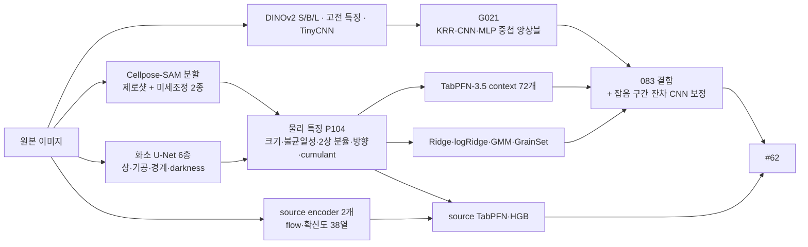

# 합성 미세구조 기반 재료 물성 예측 AI 경진대회

합성 미세구조 이미지 한 장(256×256 흑백)으로 경도(HV)를 예측하는 회귀 대회의 **최종 3위 솔루션**이다. [DAKER 합성 미세구조 기반 재료 물성 예측 AI 경진대회](https://daker.ai/public/hackathons/synthetic-microstructure-property-prediction-ai) · 작업 기간 2026-09-30 ~ 10-19

| 항목                    | 결과                                                    |
| ----------------------- | ------------------------------------------------------- |
| 최종 수상 순위          | **3위**                                                 |
| 최종 제출               | 플랫폼 #62 `candidate-source-flow38-boostedreadout.csv` |
| Public RMSE (test 30%)  | **8.8196**                                              |
| Private RMSE (test 70%) | **9.6967**                                              |

Public·Private 리더보드 순위는 잠정 결과다. 최종 수상 순위는 제출 자료, 코드 재현성, 대회 규칙 준수 여부를 확인한 뒤 확정되며, 이 저장소는 최종 평가 결과인 3위를 기준으로 기록한다. 아래 점수와 그래프는 제출별 예측 성능의 기록이다.


## 문제

- **데이터**: 라벨이 있는 train 500장, 추론용 test 1000장. 경도는 평균 194 HV, 표준편차 17.7, 범위 152–264다. 이미지마다 잡음·밝기·대비가 크게 다르다.
- **평가**: RMSE. Public은 test 30%, Private은 test 70%다. 최종 수상자는 코드·솔루션 검증을 거쳐 결정된다.
- **규칙**: 외부 데이터 금지, test를 학습에 쓰는 행위 금지. 허용 라이선스의 사전학습 가중치는 사용 가능하다.

## 핵심 아이디어

1. **측정이 정체를 깼다.** 사전학습 CNN, DINOv2, ConvNeXt 등 일반 이미지 모델은 오차가 서로 0.85–0.89로 상관해 앙상블해도 11.49에서 멈췄다. Cellpose-SAM으로 결정립을 분할해 크기 불균일성과 2상 분율을 직접 측정하자 한 번에 10.54로 내려갔다(study 220).
2. **오차는 잡음 이미지에 몰린다.** dev 오차의 절반 이상이 잡음이 가장 큰 1/3에서 나왔다. 잡음 때문에 경계가 사라지면 분할기가 이웃 결정립을 합친다. 그래서 train 원본을 열화해 Cellpose를 미세조정했고(push-300), 라벨 없이 상(phase)·기공·경계 화소 지도를 복원하는 U-Net을 학습했다(push-400).
3. **추가 측정의 효과.** 이번 실험에서는 원본 열화 사본으로 증강한 선형 파트너와 분할기의 연속 flow 특징을 추가했을 때 Public 점수가 개선됐다. dev에서 관찰한 개선이 Public에서도 유지되지는 않았다.
4. **검증과 학습.** 주요 개발 실험에는 400장의 3개 분할 × 5-fold OOF를 사용했다. 최종 학습은 train 500장을 사용하며, 잔차 CNN의 teacher는 3-fold 교차 적합으로 생성한다. 구성별 절차는 최종 재현 문서에 설명했다.

## 최종 모델 (#62)



```text
083 = 0.16·G021 + 0.384·TabPFN + 0.128·Ridge + 0.128·logRidge + 0.05·GrainSet + 0.15·GMM
      + 잡음 구간 잔차 CNN 보정
#62 = 083 + eligible·0.384·(SourceTab − ControlTab) + eligible·0.256·(SourceHGB − ControlHGB)
```

`eligible`은 분할이 정상인 이미지다. 실패한 이미지는 G021 예측을 그대로 쓴다. 학습 설정 전체는 [`final/package/REPRODUCTION.md`](final/package/REPRODUCTION.md)에 있다.

## 연구 흐름

| 기간        | 단계                                   | 한 일                                                          | Public        |
| ----------- | -------------------------------------- | -------------------------------------------------------------- | ------------- |
| 9/30–10/06  | [`studies/`](studies/) (study 174까지) | 고전 영상 특징 + KRR, TinyCNN, DINOv2 특징, 중첩 잔차 앙상블   | 12.89 → 11.49 |
| 10/06–10/07 | study 177–219                          | 사전학습 CNN·백본·학습 정책 대조. 모두 기각되고 오차 상관 진단 | 11.49         |
| 10/07–10/08 | `grain-cellpose-220`                   | Cellpose-SAM 결정립 측정, TabPFN v2                            | 10.54 → 10.40 |
| 10/08–10/10 | `push-300`, `push-400`                 | 열화 이미지로 Cellpose 미세조정, 라벨 없는 화소 U-Net          | 9.93 → 9.45   |
| 10/10–10/13 | `push-500` ~ `push-1100`               | 블록 이질성·방향·음영 특징, Ridge·GMM·GrainSet 파트너          | 9.18 → 9.04   |
| 10/14–10/18 | `push-1200` ~ `push-1500` 외           | 원본 열화 사본 증강, 잡음 구간 잔차 CNN 보정. 정보 바닥 진단   | 8.98 → 8.92   |
| 10/18–10/19 | `supervised-renewal`                   | 분할기의 연속 flow 특징, source encoder, HGB readout           | 8.87 → 8.82   |

실험 86개의 결론은 [`experiments/README.md`](experiments/README.md), 제출 62건의 점수와 변경 내용은 [`docs/submissions.md`](docs/submissions.md)에 정리했다.

## 저장소 구조

| 경로                                     | 내용                                                                    |
| ---------------------------------------- | ----------------------------------------------------------------------- |
| [`final/`](final/)                       | 최종 제출 #62 재현 패키지와 솔루션 PDF, 코드 Markdown, 제출 CSV         |
| [`experiments/`](experiments/)           | 연구 단계별로 분류한 폴더 단위 실험 86개                                |
| [`studies/`](studies/)                   | study 번호 구간별 초기 스크립트 417개와 첫 기준선 패키지 `studies/src/` |
| [`artifacts/`](artifacts/)               | 후보 예측 CSV와 산출물 안내                                             |
| [`reports/`](reports/)                   | 집계 결과·검증·제출·출처별로 분류한 기록                                |
| [`docs/`](docs/)                         | 연구 일지, 제출 이력, 실험 진단 자료                                    |
| `tests/`                                 | 특징 추출·파이프라인 테스트                                             |
| `requirements*.in`, `requirements*.lock` | 주 환경 패키지 목록                                                     |

번호 체계가 세 가지다. **플랫폼 제출 번호**(#1–#62), **후보 번호**(`submission-candidate-001`–`083`), **study 번호**(`dinob_062.py`의 062)는 서로 무관하다. 이 문서에서 #62는 최종 제출만 가리킨다.

## 재현

공개 코드는 [`final/package/`](final/package/README.md)에 있다. 해당 폴더에서 세 가상환경과 고정 버전 의존성을 설치하고, 공식 데이터를 `data/train.csv`, `data/sample_submission.csv`, `data/train/*.png`, `data/test/*.png`로 배치한다.

공식 사전학습 가중치는 `prepare_pretrained.py --download`로 준비하고, `train.py`로 대회 학습 데이터에서 가중치를 만든다. 이후 `trained/raw.py --retrained`로 예측한다. 정확한 명령은 [학습·추론 실행 안내](final/package/README.md), 단계별 구성은 [REPRODUCTION.md](final/package/REPRODUCTION.md)에 있다.

제출 당시 가중치와 비교 자산을 별도로 보유한 경우에는 `raw.py`를 사용한다. 이 자산에는 학습 라벨과 이미지 입력 캐시가 포함되므로 일반 공개 대상과 다운로드 링크에서 제외한다. 원본 데이터, 개별 샘플의 정답·잔차 기록, 이미지가 포함된 진단 결과와 학습 가중치는 로컬에 보관한다.

`studies/`와 `experiments/`의 스크립트는 기록으로 보존했다. 중간 산출물(가중치, 특징 캐시)이 없으므로 대부분 그대로는 다시 실행되지 않는다.

## 환경과 도구

- Apple M1 Pro, RAM 16GB, MPS. Python 3.13.3, PyTorch 2.14, scikit-learn 1.9.
- 분할: Cellpose 4.2 (Cellpose-SAM `cpsam`, BSD-3-Clause). 표현: DINOv2 S/B/L. 테이블 모델: TabPFN-3.5 (비상업 라이선스, `final/package/licenses/`).
- AI 코딩 에이전트(OpenAI 코딩 도구, Claude Code)를 코드 작성, 실험 실행, 검증, 문서 정리에 활용했다. 경도 예측은 모두 로컬에서 학습한 모델이 수행했다.
